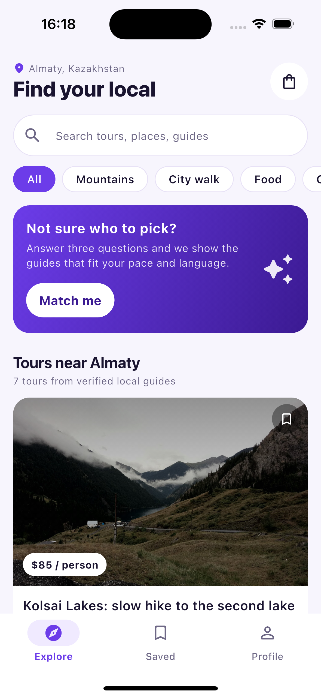
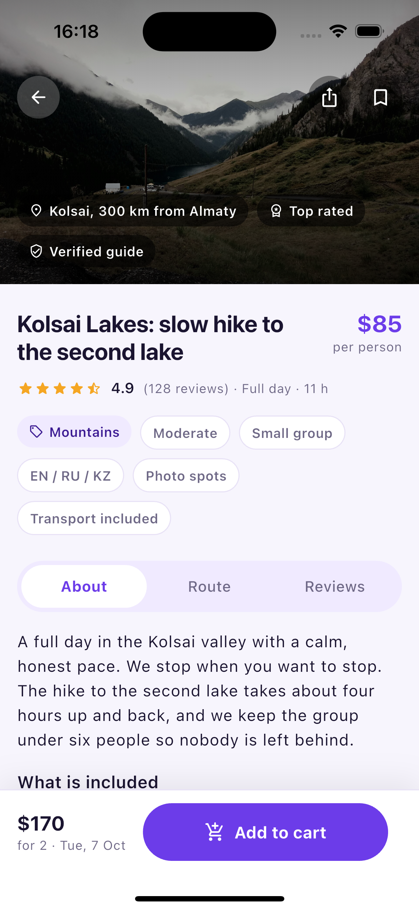
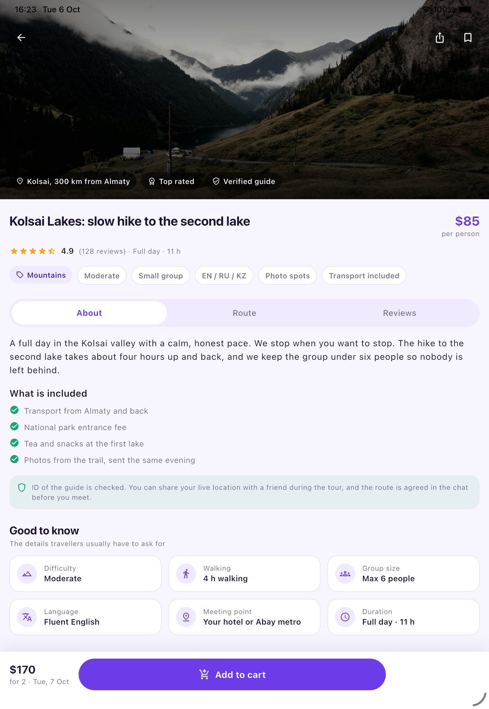

# LocalEyes

Choose the right local guide, not just any guide.

LocalEyes is a marketplace that connects travellers with independent local
guides in Almaty. This repository is **Milestone 1** of the capstone project:
the MVP user interface, built in Flutter with mock data and no backend yet.

Author: Tomiris Suleimenova, Narxoz University.

---

## The problem

* **Travellers** can find guides easily, but they cannot *choose* one. Profiles
  all look the same and never say the things that actually matter: difficulty,
  real group size, walking time, how good the guide's English really is.
  Travellers spend a median of 2 hours picking a guide, and 27% spend 5–24 hours.
* **Independent guides** have no steady flow of clients. 8 out of 8 independent
  guides lose a median of 4 days a month, which is about **$280 of lost income**,
  and spend up to 24 hours a week looking for clients on Instagram and TikTok.

So the app is built around one job: help the traveller **choose**, and help the
guide **fill empty dates with clients they can trust**.

## Who it is for

* **Travellers** — independent travellers aged 23–35 who search on Instagram,
  TikTok and Google Maps, read reviews, and still cannot tell which guide fits
  their interests, pace, language and group size.
* **Guides** — independent guides in Almaty and Worldwide, 23–40 years old, 1–7 years of experience, speaking RU / EN / KZ.

---

## Screens

| Discovery feed | Tour detail | Tour detail on a tablet |
| --- | --- | --- |
|  |  |  |

1. **Explore** — search field, category chips, the matching card, and a grid of
   tour cards.
2. **Tour detail** — cover photo with a bookmark badge, title, star rating,
   price, category badges, three tabs (About / Route / Reviews), honest tour
   facts, the guide, dates, group size, and a sticky "Add to cart" bar.
3. **Saved** — everything the bookmark badge collected.
4. **Profile** — the traveller's own profile, interests and safety settings.
5. **Cart** — what was added from the detail screen, with the booking request.
6. **Register** — account creation with full form validation, a terms
   checkbox and a role dropdown (reached from Profile).
7. **Locals** — the people who live here, with availability filters, their
   profiles and a meetup request form.
8. **Catalog** — the same items as a lazy list or a 2-column grid, with
   pull-to-refresh, swipe-to-delete, undo and an empty state (reached from the
   grid button in the Explore app bar).
9. **Cart** — what the badge counts: every added tour, a delete button on each
   row, the total, and "Clear All".

## Interactive features (StatefulWidget + setState)

| Feature | Where |
| --- | --- |
| Bookmark badge with a press animation | `lib/widgets/bookmark_badge.dart` |
| Category filter chips | `lib/screens/discovery_screen.dart` |
| Live search field | `lib/screens/discovery_screen.dart` |
| Matching quiz (3 questions) that filters the feed | `lib/widgets/match_sheet.dart` |
| About / Route / Reviews tab toggle | `lib/screens/tour_detail_screen.dart` |
| Group size stepper that recalculates the total price | `lib/screens/tour_detail_screen.dart` |
| Date picker chips | `lib/screens/tour_detail_screen.dart` |
| Bottom navigation | `lib/screens/home_shell.dart` |
| Registration form: live validation, password visibility, terms checkbox, role dropdown | `lib/screens/register_screen.dart` |
| Catalog list / grid toggle, pull-to-refresh, swipe-to-delete with undo | `lib/screens/catalog_screen.dart` |
| Global cart: add-to-cart toggles, live app-bar badge, total, Clear All | `lib/state/cart_provider.dart` |

Saved tours and saved locals live in one `ChangeNotifier`
(`lib/state/app_state.dart`) shared through an `InheritedNotifier`, so the
bookmark reacts the same way on every screen. The cart is a second
`ChangeNotifier` (`lib/state/cart_provider.dart`), wired with the `provider`
package — see [The global cart](#the-global-cart-changenotifier--provider).
BLoC replaces both in Milestone 3.

## Navigation

The app has one root screen with a `BottomNavigationBar` and pushes a detail
screen on top of it.

### Root screen — four tabs

`lib/screens/home_shell.dart` holds the selected tab index in a
`StatefulWidget` and swaps the body with `setState`:

| Tab | Screen | What it shows |
| --- | --- | --- |
| 1 · Explore (feed) | `discovery_screen.dart` | 7 tours as cards with a photo, title, category and price per person |
| 2 · Saved (favourites) | `saved_screen.dart` | the tours the bookmark badge collected |
| 3 · Profile | `profile_screen.dart` | the traveller's profile, interests and settings |
| 4 · Locals | `locals_screen.dart` | the people who live here and are up for meeting |

The four tabs sit inside an `IndexedStack`, so they are built once and kept
alive. Switching tabs — or coming back from the detail screen — does **not**
rebuild them: the search text, the category chip and the scroll position are
exactly where they were left.

### Pushing the detail screen with the object

Tapping a card calls `Navigator.push` and hands the **whole `Tour` object** to
the next screen as a constructor argument, so the detail screen already has the
title, summary, photo, price and category and never has to look them up again:

```dart
// lib/screens/discovery_screen.dart
void _openTour(Tour tour) {
  Navigator.of(context).push(
    MaterialPageRoute<void>(
      builder: (BuildContext context) => TourDetailScreen(tour: tour),
    ),
  );
}
```

```dart
// lib/screens/tour_detail_screen.dart
class TourDetailScreen extends StatefulWidget {
  const TourDetailScreen({super.key, required this.tour});

  final Tour tour; // the complete object that was passed in
```

The Saved tab pushes the same screen the same way, so a tour opens identically
from either tab.

### Two ways back, both `Navigator.pop`

1. **The AppBar arrow.** `TourDetailScreen` has an `AppBar` with the tour title.
   Because the screen was pushed onto the navigator, Flutter adds the back arrow
   automatically and it calls `Navigator.pop` for us.
2. **The in-body button.** At the bottom of the detail screen there is a
   "Back to tours" button:

```dart
OutlinedButton.icon(
  onPressed: () => Navigator.of(context).pop(),
  icon: const Icon(Icons.arrow_back_rounded, size: 19),
  label: const Text('Back to tours'),
)
```

Both return to the tab that opened the screen without restarting it. Saved
tours and the cart live in the shared `AppState`, and the tabs survive in the
`IndexedStack`, so anything bookmarked or added to the cart on the detail screen
is already visible when the screen pops.

`test/layout_overflow_test.dart` checks all of this: that a tap pushes
`TourDetailScreen` carrying the right tour data, that both back buttons pop it,
and that a search typed before opening a tour is still in the field afterwards.

## Dynamic lists, grids and touch gestures

The catalog screen (`lib/screens/catalog_screen.dart`) shows the same data two
ways and answers to three gestures.

| Piece | How it is built |
| --- | --- |
| **List feed** | `ListView.separated` — avatar icon, title, category tag, star rating and price per row, with a 1 px `Divider` from `separatorBuilder` |
| **Grid catalog** | `GridView.builder`, `crossAxisCount: 2`, `childAspectRatio: 0.72` |
| **Toggle** | an `IconButton` in the `AppBar` that flips `CatalogView` with `setState` |
| **Pull-to-refresh** | `RefreshIndicator` → `await Future.delayed(1500 ms)` → `_items.insert(0, …)` |
| **Swipe-to-delete** | `Dismissible` with `key: ValueKey(item.id)`, `endToStart`, red background with `Icons.delete` — in **both** the list and the grid |
| **Undo** | a floating `SnackBar` whose action does `_items.insert(index, item)`, so the item lands back on its old row, not on top |
| **Empty state** | `EmptyState` with "Catalog is Empty" and a "Reset Catalog" button that re-seeds the data |

Both builders are lazy on purpose. A `Column` inside a `SingleChildScrollView`
builds every row up front and keeps them all in memory; `ListView.separated`
and `GridView.builder` only build what is on screen plus a small cache, which
is what keeps a long catalog cheap on a phone.

The `ValueKey` is built from the item **id**, never from the index: with an
index key Flutter would animate away the wrong row once the list shifted after
a removal.

Both lists use `AlwaysScrollableScrollPhysics` and the empty state is itself a
`ListView`, so pull-to-refresh still works when the catalog is short or empty.

`test/catalog_test.dart` covers all of it: the divider and the grid delegate,
the 1500 ms refresh landing at index 0, a swipe in each view, the undo coming
back at the original position, and the empty state with its reset.

## The global cart (ChangeNotifier + Provider)

Two screens, one cart. `CartProvider` (`lib/state/cart_provider.dart`) is a
`ChangeNotifier` that owns the whole truth about what has been added; no screen
keeps a copy, so there is nothing to keep in sync by hand.

```dart
// lib/main.dart — above MaterialApp, so every pushed route sees the same cart
return ChangeNotifierProvider<CartProvider>(
  create: (BuildContext context) => CartProvider(),
  child: AppScope(
    notifier: _appState,
    child: MaterialApp(home: const HomeShell()),
  ),
);
```

| Piece | How it is built |
| --- | --- |
| **The cart itself** | `Map<String, CartItem>` keyed by tour id — a tour cannot be added twice, and a `Map` keeps insertion order, so the cart lists tours in the order they were added |
| **Screen 1 · the feed** | every card carries an Add to cart / In cart toggle; the button's state is read from the provider, never from a local `bool` |
| **Live badge** | `CartBadgeButton` calls `context.watch<CartProvider>()`, so only the button rebuilds when the count changes |
| **Screen 2 · the cart** | every added tour with its own delete button, the total in the booking bar, and "Clear All" with an UNDO SnackBar |
| **Total** | `CartProvider.total` folds price × travellers — the screen displays a number it never calculates |
| **Two ways in** | the toggle on a card adds one traveller on the first free date; the detail screen adds the same tour with a chosen date and group size, and the toggle then reads "In cart" |

Three different ways of reading the provider, each picked for a reason:

* `context.watch<CartProvider>()` — the cart screen and the badge depend on the
  whole object, so they subscribe to it.
* `context.select<CartProvider, bool>((c) => c.contains(tour.id))` — a card
  only cares whether **its** tour is in the cart, so it rebuilds when that one
  boolean flips and sits still when another card changes.
* `context.read<CartProvider>()` — inside button callbacks, where the object is
  needed to call a method on and a subscription would be pure waste.

Because every screen reads the same object, deleting a tour on the cart screen
has already flipped its card back to "Add to cart" and dropped the badge by one
before the back arrow is pressed. `test/cart_provider_test.dart` proves exactly
that: it adds two tours from the feed, opens the cart, deletes one, walks back,
and checks the badge and the button states — and does the same round trip
through the detail screen.

The booking cart is the only state that moved: saved tours, saved locals and
meetup requests still live in `AppState` behind the `InheritedNotifier`.

## Layout and responsiveness

* `Stack` — cover photo, gradients, share button and the bookmark badge
  (`lib/widgets/cover_header.dart`), and the price badge on every card.
* `Row` + `Expanded` — title next to price, rating next to duration, and the
  sticky bar where the main button takes all the remaining width
  (`lib/widgets/booking_bar.dart`).
* `Wrap` — category badges, tour facts and interest tags move to the next line
  instead of overflowing.
* `LayoutBuilder` — the detail screen is one column below 840 px and two columns
  above it; the facts grid switches between two and three columns.
* The feed uses `SliverGridDelegateWithMaxCrossAxisExtent`, so it is one column
  on a phone and two or three on a tablet.

### Zero RenderFlex overflow

`test/layout_overflow_test.dart` opens the feed, the saved screen, the profile
and **every** tour detail screen (including all three tabs and the bottom of the
page) at six screen sizes, from 320×568 to 1280×800, and fails if Flutter
reports any overflow. `test/register_form_test.dart` does the same for the
registration screen at four sizes, with every field in its error state — the
tallest the form can get. `test/locals_layout_test.dart` covers the locals
screens, `test/catalog_test.dart` checks both catalog views at 320×568,
390×844 and 768×1024 including the grid after a scroll, and
`test/cart_provider_test.dart` does the same for the feed with a full cart.

```
flutter test
# 92 tests passed
flutter analyze
# No issues found
```

## Design files

Figma-ready artboards live in `design/figma/` — a UI kit plus the three screens
as SVG. Drag them into Figma and they open as editable layers.
See `design/README.md`.

## Folder structure

```
lib/
├── core/          app_theme.dart — colours, spacing, text styles
├── models/        guide.dart, review.dart, tour.dart, local_person.dart,
│                  spot.dart, catalog_item.dart, cart_item.dart
├── data/          mock_tours.dart, mock_locals.dart, catalog_seed.dart —
│                  demo data, replaced by a REST API later
├── state/         app_state.dart — saved tours and locals (AppScope)
│                  cart_provider.dart — the cart (ChangeNotifier + provider)
├── screens/       home_shell, discovery, tour_detail, saved, cart, profile,
│                  register, locals, local_profile, meetup_request, spots,
│                  become_local, catalog
└── widgets/       tour_card, cover_header, booking_bar, bookmark_badge,
                   tag_chip, rating_stars, fact_tile, guide_strip,
                   quantity_stepper, avatar_circle, section_header,
                   match_sheet, empty_state, local_card, hangout_row,
                   availability_pill, spot_card, catalog_list_tile,
                   catalog_grid_card, cart_badge_button, cart_toggle_button
```

```
design/figma/      00-ui-kit, 01-explore, 02-tour-detail, 03-profile  (SVG)
docs/screenshots/  simulator screenshots used in this README
```

## Run it

```bash
flutter pub get
flutter run
```

Tested with Flutter 3.47.2 (Dart 3.13.2) on the iOS Simulator.

## Roadmap

* **Milestone 2** — REST API, real guide and tour data, chat.
* **Milestone 3** — local database, BLoC architecture, AI matching.


