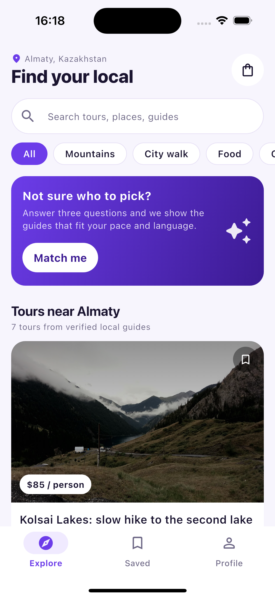
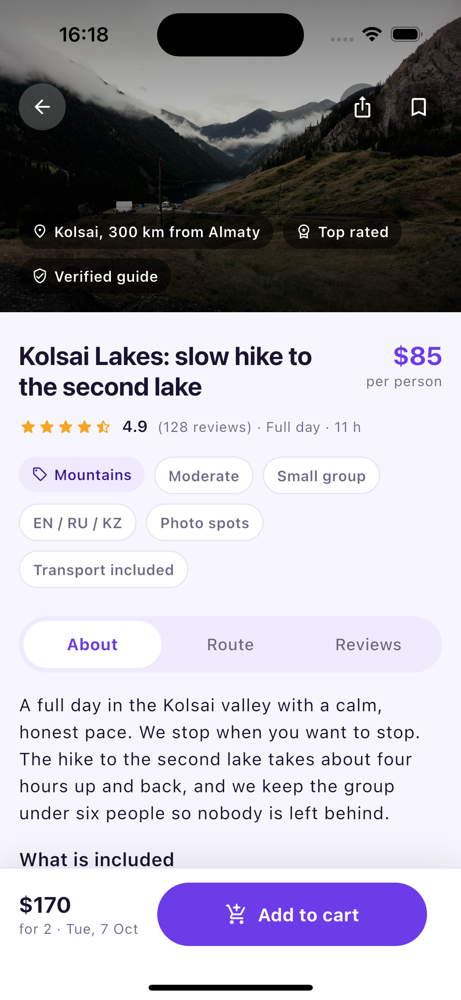
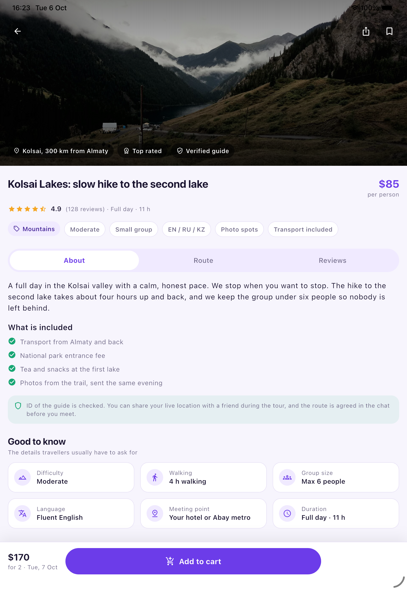

# LocalEyes

Choose the right local guide, not just any guide.

LocalEyes is a marketplace that connects travellers with independent local
guides in Almaty. This repository is **Milestone 1** of the capstone project:
the MVP user interface, built in Flutter with mock data and no backend yet.

Author: Tomiris Suleimenova, Narxoz University.

---

## The problem

In 50 Mom Test interviews (47 used after cleaning: 34 travellers, 13 guides)
two things came up again and again:

* **Travellers** can find guides easily, but they cannot *choose* one. Profiles
  all look the same and never say the things that actually matter: difficulty,
  real group size, walking time, how good the guide's English really is.
  Travellers spend a median of 2 hours picking a guide, and 27% spend 5–24 hours.
* **Independent guides** have no steady flow of clients. 8 out of 8 independent
  guides lose a median of 4 days a month, which is about **$280 of lost income**,
  and spend up to 24 hours a week looking for clients on Instagram and TikTok.

So the app is built around one job: help the traveller **choose**, and help the
guide **fill empty dates with clients they can trust**.

## Who it is for

* **Travellers** — independent travellers aged 23–35 who search on Instagram,
  TikTok and Google Maps, read reviews, and still cannot tell which guide fits
  their interests, pace, language and group size.
* **Guides** — independent guides in Almaty, 23–40 years old, 1–7 years of
  experience, speaking RU / EN / KZ.

---

## Screens

| Discovery feed | Tour detail | Tour detail on a tablet |
| --- | --- | --- |
|  |  |  |

1. **Explore** — search field, category chips, the matching card, and a grid of
   tour cards.
2. **Tour detail** — cover photo with a bookmark badge, title, star rating,
   price, category badges, three tabs (About / Route / Reviews), honest tour
   facts, the guide, dates, group size, and a sticky "Add to cart" bar.
3. **Saved** — everything the bookmark badge collected.
4. **Profile** — the traveller's own profile, interests and safety settings.
5. **Cart** — what was added from the detail screen, with the booking request.

## Interactive features (StatefulWidget + setState)

| Feature | Where |
| --- | --- |
| Bookmark badge with a press animation | `lib/widgets/bookmark_badge.dart` |
| Category filter chips | `lib/screens/discovery_screen.dart` |
| Live search field | `lib/screens/discovery_screen.dart` |
| Matching quiz (3 questions) that filters the feed | `lib/widgets/match_sheet.dart` |
| About / Route / Reviews tab toggle | `lib/screens/tour_detail_screen.dart` |
| Group size stepper that recalculates the total price | `lib/screens/tour_detail_screen.dart` |
| Date picker chips | `lib/screens/tour_detail_screen.dart` |
| Bottom navigation | `lib/screens/home_shell.dart` |

Saved tours and the cart live in one `ChangeNotifier` (`lib/state/app_state.dart`)
shared through an `InheritedNotifier`, so the bookmark reacts the same way on
every screen. No state-management package is used in Milestone 1 — this is the
place where BLoC will go in Milestone 3.

## Layout and responsiveness

* `Stack` — cover photo, gradients, back / share buttons and the bookmark badge
  (`lib/widgets/cover_header.dart`), and the price badge on every card.
* `Row` + `Expanded` — title next to price, rating next to duration, and the
  sticky bar where the main button takes all the remaining width
  (`lib/widgets/booking_bar.dart`).
* `Wrap` — category badges, tour facts and interest tags move to the next line
  instead of overflowing.
* `LayoutBuilder` — the detail screen is one column below 840 px and two columns
  above it; the facts grid switches between two and three columns.
* The feed uses `SliverGridDelegateWithMaxCrossAxisExtent`, so it is one column
  on a phone and two or three on a tablet.

### Zero RenderFlex overflow

`test/layout_overflow_test.dart` opens the feed, the saved screen, the profile
and **every** tour detail screen (including all three tabs and the bottom of the
page) at six screen sizes, from 320×568 to 1280×800, and fails if Flutter
reports any overflow.

```
flutter test
# 15 tests passed
```

## Design files

Figma-ready artboards live in `design/figma/` — a UI kit plus the three screens
as SVG. Drag them into Figma and they open as editable layers.
See `design/README.md`.

## Folder structure

```
lib/
├── core/          app_theme.dart — colours, spacing, text styles
├── models/        guide.dart, review.dart, tour.dart
├── data/          mock_tours.dart — demo data, replaced by a REST API later
├── state/         app_state.dart — saved tours and cart, shared via AppScope
├── screens/       home_shell, discovery, tour_detail, saved, cart, profile
└── widgets/       tour_card, cover_header, booking_bar, bookmark_badge,
                   tag_chip, rating_stars, fact_tile, guide_strip,
                   quantity_stepper, avatar_circle, section_header,
                   match_sheet, empty_state
```

```
design/figma/      00-ui-kit, 01-explore, 02-tour-detail, 03-profile  (SVG)
docs/screenshots/  simulator screenshots used in this README
```

## Run it

```bash
flutter pub get
flutter run
```

Tested with Flutter 3.47.2 (Dart 3.13.2) on the iOS Simulator.

## Roadmap

* **Milestone 2** — REST API, real guide and tour data, chat.
* **Milestone 3** — local database, BLoC architecture, AI matching.

## Photo credits

All cover photos come from Wikimedia Commons and are used under free licences.

| Image | Author | Licence |
| --- | --- | --- |
| Kolsai lakes | Dimash Kenesbek | CC BY-SA 4.0 |
| Charyn Canyon | Bgag | CC0 |
| Shymbulak | Matti Blume | CC BY-SA 4.0 |
| Medeu | Matti Blume | CC BY-SA 4.0 |
| Big Almaty Lake | BitLord~ruwiki | CC BY-SA 4.0 |
| Kok Tobe sunset | User:Vmenkov | CC BY-SA 3.0 |
| Zenkov Cathedral | Bgag | CC0 |

Guide and traveller avatars are drawn from initials, so no photo of a real
person is used in the demo.
